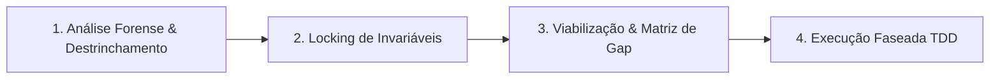

# Forensic Invariant Workflow (FIW)

> **Core Philosophy:** *Evidence before opinion. Invariants before innovation. Proof before claims.*  
> Nenhuma alteração estética, de performance ou de dinâmica pode ser executada sem antes desmontar a referência aos seus componentes atômicos, trancar formalmente todos os contratos vigentes e desenhar uma transição comprovável via testes automatizados.

---

## 🏛️ Os 4 Pilares do Workflow

---

## 1. Fase 1: Análise Forense & Destrinchamento (Deconstruction)

Objetivo: Desmontar a referência de alta fidelidade e o código atual até às equações fundamentais, eliminando suposições e impressões visuais subjetivas.

### Ações Obrigatórias:
1. **Extração de Código-Fonte Real:**
   - Descompilar/inspecionar os scripts de produção reais (ex.: bundles minificados, shaders GLSL, listeners de evento).
   - Extrair as equações matemáticas exatas, matrizes de transformação, constantes físicas (massa, amortecimento, rigidez, FOV, Z da câmara).
2. **Mapeamento de Eventos & Inputs:**
   - Como os eventos de `wheel`, `pointerdown`, `pointermove`, `touchend` e `keydown` são calculados e normalizados?
   - Qual a fórmula de amortecimento (`lerp`, `tanh`, Euler, RK4)? Existe arremesso inercial (*flick multiplier*)?
3. **Mapeamento de Shaders & Geometria:**
   - Quais uniforms controlam deformações de vértice (`vertexShader`) e iluminação (`fragmentShader`)?
   - Como uniforms de velocidade (`u_sheetV`) interagem com uniforms de forma (`u_sheetP`, `u_sheetD`)?

---

## 2. Fase 2: Locking de Invariáveis (Hard Guardrails & Contracts)

Objetivo: Mapear e "trancar a sete chaves" todos os comportamentos funcionais, contratos de telemetria, acessibilidade e gates de teste existentes.

> 🔴 **Regra de Ouro:** Nenhuma melhoria estética pode violar as invariáveis funcionais vigentes. Se quebrar um contrato, a alteração é sumariamente rejeitada.

### Checklist de Invariáveis:
- [ ] **Máquina de Estados de Telemetria:** Nomes de fase, ordem de transição e payloads globais (ex.: `window.__WORK_STAGE__`).
- [ ] **Contratos de Teste E2E (Gates 1 a N):** Asserções de bounds, tolerâncias de opacidade, valores de uniforms no ápice e no repouso.
- [ ] **Acessibilidade & DOM:** Preservação de elementos proxy com `pointer-events: auto`, atributos `aria-hidden`, IDs de ancoragem e árvore semântica.
- [ ] **Integração Externa & Temas:** Sincronização de propriedades CSS de componentes externos (ex.: headers, footers, barras de navegação).
- [ ] **Prevenção de Deadlock de Scroll:** Manutenção do ciclo de vida contínuo da página (sem `lenis-prevent` travado em loops).

---

## 3. Fase 3: Viabilização de Implementação & Matriz de Gap (Feasibility)

Objetivo: Contrastar o estado atual com o alvo de forma neutra, quantificando as discrepâncias e desenhando a ponte técnica sem quebras.

### Matriz de Gap (Tabela Factual):
Construir uma tabela com:
1. **Eixo Cinemático / Funcional**
2. **Implementação de Referência (Equações & Valores)**
3. **Implementação Atual (Equações & Valores)**
4. **Causa Raiz & Solução de Viabilização**

### Gating & Isolamento de Efeitos Colaterais:
- Exemplo: Se uma velocidade de scroll deforma a malha 3D, como evitar que essa deformação permaneça congelada ao abrir um modal no meio de uma rolagem rápida?
- Solução: Gating explícito por progresso de voo (`u_sheetP`) e resfriamento imediato de velocidade (`velocity = 0`) no momento do clique.

---

## 4. Fase 4: Execução Faseada TDD (Verification Driven)

Objetivo: Implementar as mudanças cirurgicamente, garantindo que cada passo seja bracketado por testes antes e depois.

### Ciclo de Execução:
1. **RED (Unitário):** Escrever testes unitários para a nova matemática ou física em `math.spec.ts` antes de editar código de produção.
2. **GREEN (Cirúrgico):** Aplicar as edições estritamente no arquivo responsável (ex.: material do shader, controlador de física).
3. **BUILD & BUNDLE:** Recompilar o bundle de produção e verificar integridade de compilação (código de saída 0).
4. **GATE BATTERY (E2E & Multi-Viewport):** Rodar a suíte completa de regressão:
   - Vitest Math (100% verde).
   - Playwright Gates funcionais (Abertura, Fita, Voo, Fechamento, Scroll Contínuo).
   - Challenger Multi-Viewport (resoluções de estresse: 1440x900, 1920x1080, 1280x800, 1600x900).
5. **EVIDÊNCIA & HANDOFF:** Declarar conclusões rotuladas estritamente como `observed`, `inferred` ou `documented`, com logs reais de execução.
