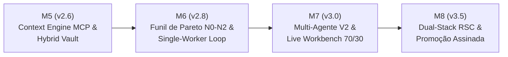

# Studio DNA Engine — Roadmap Tecnológico v3.0 Pareto

> **Documento Normativo de Evolução da Arquitetura**  
> Alinhamento Oficial: Versões v2.6 (M5) a v3.5 (M8)  
> Base de Engenharia: Interpretable Context Methodology (ICM), Perfil Low-Spec e Contratos Determinísticos.

---

## 1. Visão e Princípios de Engenharia

O **Studio DNA Engine** é uma plataforma determinística e orquestrada para geração, transmutação e verificação de interfaces web de alto padrão (nível Awwwards / Editorial Brutalist / Kinetic Luxury), operando sob isolamento estrito de contexto por cliente e contenção de hardware (Low-Spec Profile).

### Princípios Invariáveis
1. **Verdade Baseada em Evidência:** Afirmações de status exigem testes frescos e artefatos verificáveis com hash SHA-256 no `execution-ledger.js`.
2. **Isolamento Absoluto de Contexto (ICM):** O contexto de cada cliente (`clientes/<slug>/`) e referências selecionadas (`copias/<slug>/`) é hermeticamente isolado. Acesso a dados cruzados entre clientes é proibido em runtime.
3. **Contenção de Recursos (Low-Spec Profile):** O consumo de CPU/GPU e memória é estritamente controlado. Execuções Playwright rodam sempre com um único worker Chromium (`--workers=1`).
4. **Governança com Autoridade Humana:** Nenhuma IA pode auto-aprovar direção de arte (`H02`) ou promoção para produção (`H03`).
5. **Ponderação Pareto 70/30:** Foco concentrado onde reside o valor perceptível do design ($70\%$ percepção estética/direção visual calibrada, $30\%$ métricas técnicas e de performance).

---

## 2. Fronteiras de Escopo e Eliminação de Armadilhas (Anti-Scope Creep)

Para preservar a estabilidade, a conformidade legal e a viabilidade do hardware de referência, os seguintes itens foram **formalmente removidos do escopo**:

| Item Removido | Justificativa Técnica & Decisão | Substituto Oficial no Roadmap |
|---|---|---|
| **Cluster distribuído de proxies antibot (Turnstile/DataDome) em M5** | Risco de violação de termos de serviço, complexidade operacional de infraestrutura externa e custo desnecessário. | ICM com ingestão de referências devidamente autorizadas e pacotes congelados em `copias/`. |
| **3D Gaussian Splatting pesado para mobile em M7** | Consumo excessivo de VRAM ($>150\text{ MB}$), throttling térmico severo e incompatibilidade com dispositivos low-end. | Pipeline ultraleve de shaders e assets 3D KTX2/ASTC comprimidos ($<3\text{ MB}$ disco, $<4\text{ MB}$ VRAM). |
| **Deploy autônomo sem aprovação humana em M8** | Risco crítico de regressões visuais ou promocionais em ambientes de produção sem supervisão executiva. | Protocolo de Promoção Assinada `verified` $\rightarrow$ `production` com Gates H01, H02 e H03 registrados no `ExecutionLedger`. |

---

## 3. Marcos de Evolução (Milestones M5 a M8)

---

### M5 (v2.6) — Context Engine MCP, Índice Híbrido SQLite DTFV + 7 Eixos UX & Vault Off-Git

**Status:** Concluído / Verificado  
**Objetivo:** Transformar o Design Vault e a ingestão de contexto em um servidor Model Context Protocol (MCP) com recuperação vetorial e semântica de alta precisão.

#### Componentes Entregues:
* **Servidor MCP Modular (`src/mcp/index.js`):** Superfície completa com ferramentas para scraping seguro, criação de clientes, transmutação, compilação, poda de contexto e auditoria de qualidade.
* **Índice Híbrido SQLite (`src/vault/hybrid-index.js`):**
  Combinação matemática de três eixos com relevância mínima $0.35$:
  $$\text{Score}(q, d) = 0.45 \cdot \cos(\vec{v}_{\text{topo}}^{(q)}, \vec{v}_{\text{topo}}^{(d)}) + 0.35 \cdot \cos(\vec{v}_{\text{ux}}^{(q)}, \vec{v}_{\text{ux}}^{(d)}) + 0.20 \cdot \text{BM25/IDF}(q, d)$$
  * Vetor Topológico 12D ($\vec{v}_{\text{topo}}$): profundidade DOM, densidade de nós, razão de layouts flex/grid, etc.
  * Vetor UX em 7 Eixos ($\vec{v}_{\text{ux}}$): hierarquia visual, cadência de scroll, contraste, tempo de leitura, interatividade, estabilidade e densidade de informação.
  * BM25/IDF: busca léxica sobre termos descritivos e componentes.
* **Compilador W3C DTCG Tokens (`src/compiler/dtcg-token-compiler.js`):**
  Suporte nativo aos padrões do W3C Design Tokens Community Group (`$value`, `$type`, aliases e composite tokens).
* **Poda Determinística de Contexto (`src/mcp/tools/context-pruning-tools.js`):**
  Redução de payload para $<15\text{ KB}$ mantendo apenas os seletores e tokens indispensáveis para a tarefa solicitada.
* **Vault Off-Git:** Armazenamento de assets binários pesados isolados em cache local, evitando inchaço do repositório Git.

---

### M6 (v2.8) — Funil de Pareto Níveis 0–2 & Boulder Loop Single-Worker

**Status:** Concluído / Verificado  
**Objetivo:** Filtrar $80\%$ dos defeitos estruturais e visuais nas camadas de custo computacional quase nulo, reservando o navegador para validações de alta fidelidade.

#### Arquitetura do Funil de Verificação:
1. **Nível 0 — Hooks AST Puros ($< 80\text{ ms}$):**
   * Análise sintática estática com Cheerio sem abrir processos de navegador.
   * Validação de contratos HTML, tags obrigatórias, data-attributes (`data-slot`, `data-kinetic-slot`) e classes utilitárias.
2. **Nível 1 — Domscribe Delta Determinístico ($< 400\text{ ms}$):**
   * Atribuição de identificadores hexadecimais de 8 caracteres determinísticos (`data-ds`) e linhas de origem (`data-dna-line`) via `src/dev/domscribe-manifest.js`.
   * Geração de `.domscribe/manifest.jsonl` para permitir verificação de diferenças por bloco, sem recalcular a página inteira.
3. **Nível 2 — Boulder Loop em Chromium Single-Worker (`--workers=1`):**
   * Execução Playwright contida para capturas visuais e extração de telemetria cinética (`window.__DNA_TELEMETRY__`).
   * Eliminação de contenção de CPU em máquinas low-spec ou servidores de CI com 2 vCPUs.

---

### M7 (v3.0) — Orquestração Multi-Agente Governada V2, Regra 70/30 & DNA Live Workbench

**Status:** Em Finalização / Baseline Verificada  
**Objetivo:** Orquestrar agentes especializados com travas criptográficas contra escrita concorrente, crítica visual calibrada por crop regional e interação bidirecional em tempo real.

#### Componentes Principais:
1. **Governança Determinística V2 (`src/orchestration/`):**
   * Contratos de Tarefa V2 com `readAllowlist`, `writeAllowlist` e papéis declarados.
   * `dag-scheduler.js` com detecção de dependências e bloqueio de tarefas mutáveis com sobreposição de escrita.
   * `policy-enforcer.js` com verificação de limites em runtime.
   * Registro append-only de eventos criptográficos com encadeamento de hashes (`appendChainedEvent`) no `execution-ledger.js`.
2. **Visual Critic Gate Ponderado em 70/30 com Region Crop Pairs (`src/qa/`):**
   * Avaliação focada: $70\%$ peso na experiência visual perceptível (APCA $L_c$, saliência focal de Itti-Koch e detecção de sobreposição AABB $0\text{px}^2$) e $30\%$ em conformidade técnica de código.
   * Análise por pares de recorte (`regionCropPairs`), inspecionando exclusivamente regiões de alto impacto (Hero, Call-to-Action, Cards de Produto) em vez de screenshots fullscreen diluídos.
3. **DNA Live Workbench & Ponte Bidirecional Click-to-MCP (`src/dev/dev-hud.js` + `src/server/preview-server.js`):**
   * **Click-to-MCP (`Alt + Click`):** Qualquer clique sobre um elemento com `data-ds` envia os estilos computados, bounding box, variáveis `@scope` e telemetria para `POST /__dna_live_select`, refletindo no recurso dinâmico MCP `client://{slug}/live-selection`.
   * **Hot-Swap de 3 Direções:** Alternância em tempo real sem reload entre `T03A` (Systemic-clean), `T03B` (Editorial-minimal) e `T03C` (Expressive-bold).
   * **7 Verbos Impeccable:** Mutações instantâneas via `bolder`, `quieter`, `distill`, `typeset`, `polish`, `animate` e `harden`.
   * **Aprovação Humana H02:** Botão que assina e congela a direção escolhida no `ExecutionLedger` e em `human-decision.json`.

---

### M8 (v3.5) — Compilação Dual-Stack Multi-Página Next.js 15 App Router RSC & Promoção Assinada

**Status:** Próximo Marco Estrutural  
**Objetivo:** Gerar aplicações de nível corporativo prontas para deploy global, combinando HTML ultra-rápido para borda com Next.js 15 Server Components e transição governada para produção.

#### Metas de Engenharia:
1. **Compilação Dual-Stack Unificada:**
   * **Target Edge Static:** Arquitetura HTML/CSS vanilla zero-bundle com GSAP e Lenis carregados condicionalmente para LCP $< 600\text{ ms}$.
   * **Target Next.js 15 App Router:** Conversão AST determinística para React Server Components (RSC) com `"use client"` estritamente contido nos nós interativos e slots cinéticos.
2. **Suporte Multi-Página com DNA Hierárquico:**
   * Páginas filhas (`/sobre`, `/servicos`, `/contato`) herdam o `DNA.md` da raiz com overrides locais declarados e auditados pelo Anti-Slop Gate.
3. **Promoção Assinada `verified` $\rightarrow$ `production`:**
   * Máquina de estados finitos (`promotion-state-machine.js`) com três assinaturas humanas obrigatórias:
     * **H01:** Aprovação de Fontes e Direitos de Uso / Licença.
     * **H02:** Aprovação de Direção Visual (Art Direction) via DNA Live Workbench.
     * **H03:** Aprovação Final de Release de Produção vinculada ao mesmo SHA-256 do artefato verificado.
   * Bloqueio absoluto contra promoções automatizadas ou geradas por agentes de IA.

---

## 4. Matriz de Critérios de Aceite (Definition of Done)

| Marco | Critério de Aceite Técnico (DoD) | Evidência Exigida |
|---|---|---|
| **M5** | Todas as ferramentas MCP registradas; SQLite híbrido com score vetorial; W3C tokens válidos. | `node --test test/mcp-server.test.js test/dtcg-token-compiler.test.js` |
| **M6** | Verificação AST N0 $<80\text{ ms}$; Domscribe Delta N1 $<400\text{ ms}$; Playwright rodando em 1 worker. | `node --test test/delta-component-verifier.test.js test/ast-injector-resilience.test.js` |
| **M7** | Alt+Click refletido no MCP; Hot-swap de direções ativo; H02 registrado no ledger; 70/30 validado. | `node --test test/live-workbench-bridge.test.js test/preview-server.integration.test.js` |
| **M8** | Next.js 15 RSC build limpo; 0 erros em páginas secundárias; transição `verified -> production` assinada. | `node --test test/promotion-state-machine.test.js test/m4-compiler-dualstack.test.js` |

---

## 5. Procedimentos de Rollback e Segurança

* **Preservação de Evidências:** Em caso de regressão ou falha de gate, os arquivos do `execution-ledger.js` e os snapshots em `.domscribe/` **nunca são deletados**, servindo como trilha de auditoria forense.
* **Isolamento de Branches:** Todo trabalho material de milestone ocorre em branches dedicadas (`feat/pareto-v3-engine`) com merges condicionados a 100% de testes verdes.
* **Fail-Closed:** Qualquer falha em testes de integração ou divergência de SHA-256 reverte automaticamente o estado de promoção do artefato para `candidate` ou `experimental`.
