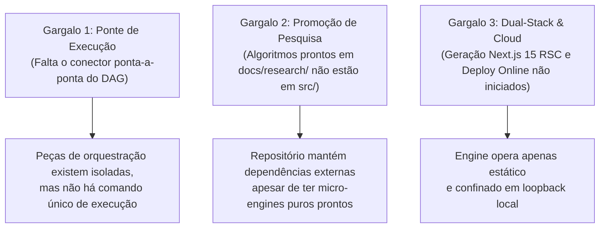

# Studio DNA Engine — Diagnóstico de Frentes, Lacunas e Roadmap Técnico

> **Classificação de Governança:** Documento de Auditoria e Engenharia (`AGENTS.md` Truth Protocol)  
> **Status:** `[observed]` (código e testes em runtime), `[documented]` (roadmaps normativos), `[inferred]` (análise de gap arquitetural)  
> **Ambientes Alvo:** `playwright-scraper` (desenvolvimento ativo) e `studio-dna-engine` (distribuição limpa)  
> **Data:** 2026-11-10  

---

## 1. Resumo Executivo

O **Studio DNA Engine** acumulou avanços técnicos de alto padrão de engenharia matemática, determinismo e contenção de hardware (AST anti-slop, persistência híbrida SQLite WAL + NoSQL, validação de contrastes APCA, identificação física inversa de molas e matrizes de teste 4-tier).

Contudo, a análise forense cruzada entre a documentação normativa ([`ROADMAP.md`](file:///c:/Users/wd/Documents/playwright-scraper/ROADMAP.md), [`design-quality-orchestrator-roadmap.md`](file:///c:/Users/wd/Documents/playwright-scraper/design-quality-orchestrator-roadmap.md), [`LOW_SPEC_MASTER_EXECUTION_PLAN.md`](file:///c:/Users/wd/Documents/playwright-scraper/LOW_SPEC_MASTER_EXECUTION_PLAN.md), [`docs/DESIGN_CAPABILITY_ROADMAP_V2.md`](file:///c:/Users/wd/Documents/playwright-scraper/docs/DESIGN_CAPABILITY_ROADMAP_V2.md)), os relatórios de branches ([`CONFLICT_REPORT.md`](file:///c:/Users/wd/Documents/playwright-scraper/CONFLICT_REPORT.md)) e a árvore de código em `src/` revela que **diversas frentes foram atacadas com protótipos de alta densidade, mas não foram conectadas ao pipeline principal ou sequer saíram da fase de especificação**.

Este documento consolida o inventário factual de todas essas frentes, organizadas por grau de maturidade e impacto arquitetural.

---

## 2. Matriz Consolidada de Frentes e Lacunas

| Frente de Engenharia | Status Real | O que foi Entregue | O que Ficou Pendente / Não Implementado |
| :--- | :---: | :--- | :--- |
| **1. Orquestrador de Qualidade de Design V2** | **Parcial (70%)** | Contratos V2, Policy Enforcer, DAG Scheduler anti-colisão, FSM de promoção, Visual Critic Gate 70/30 e matriz de captura. | **Tarefas 5, 6 e 10 do Roadmap:** `reference-packet-builder.js`, `direction-compiler.js` (geração de 3 direções A/B/C) e o runner do piloto adversarial `run-design-orchestrator-pilot.js`. |
| **2. Compilação Dual-Stack & Multi-Página (M8)** | **Não Iniciado (10%)** | Edge Static Compiler (HTML estático único) e testes de contrato básico. | Compilador determinístico para **Next.js 15 App Router RSC** e arquitetura de páginas secundárias hierárquicas (`/sobre`, `/servicos`, `/contato`) com herança de `DNA.md`. |
| **3. DNA Live Workbench & Click-to-MCP** | **Parcial (40%)** | HUD no browser (`dev-hud.js`), rotas HTTP de seleção/mutação e IDs Domscribe (`data-ds`). | **Ponte dinâmica Click-to-MCP** (`Alt+Click` refletindo em recurso dinâmico MCP em tempo real), os **7 verbos Impeccable** funcionais e o **Hot-Swap de 3 direções** sem reload. |
| **4. Motores Zero-Dependency v2.6 (Pilares 6–11)** | **Fase de Pesquisa (30%)** | Especificações matemáticas completas e protótipos de referência isolados em `docs/research/v2.6/reference/`. | **Nenhum dos 5 micro-motores foi promovido para `src/`**: `spatial-rtree.js`, `slug-font-compiler.js`, `png-codec.js`, `css-selector-ast.js` e `<dna-capsule>` / `UniversalScrollBus`. |
| **5. Classificador Jev & Contratos de Movimento** | **Não Iniciado (15%)** | Interceptador de animações no CDP e manifestos documentais (`jev-motion-foundation.md`). | Motor autônomo de classificação Jev (`src/motion/jev-classifier.js`), extração de `motion-contract.json` e execução em *shadow mode*. |
| **6. Hub 21st.dev, GenUI & Component Ingestor** | **Parcial (50%)** | 8 arquétipos canônicos de componentes em `design-vault/components/`, Clean Room Compiler e adapter inicial de shadcn. | Ingestor autônomo de componentes externos da web, pipeline automatizado de conversão em cápsulas do Vault e integração Penpot bidirecional. |
| **7. Execução Autônoma Scoped Gemini** | **Parcial (60%)** | Pacotes de tarefas compactos (`task-package-builder.js`), catálogo de tools, fingerprint de erros e limitador de reparo (3x). | Runner de loop fechado em tempo real com a API oficial do Gemini rodando em contínuo (os testes rodam apenas sobre fixtures simuladas). |
| **8. Nuvem, Deploy e Banco de Dados Remoto** | **Parcial (35%)** | SQLite local em WAL mode (`studio_dna.db`), NoSQL DocumentStore, Dockerfile multi-stage e GitHub Actions básico. | Sincronização remota do banco (Neon/Postgres/S3), deploy contínuo em VPS/Cloud Run/Railway e suporte a instâncias em nuvem autenticadas. |

---

## 3. Detalhamento Técnico por Frente de Trabalho

### Frente 1: Orquestrador de Qualidade de Design & Multi-Agente V2
*Base normativa:* [`design-quality-orchestrator-roadmap.md`](file:///c:/Users/wd/Documents/playwright-scraper/design-quality-orchestrator-roadmap.md) e [`ROADMAP.md`](file:///c:/Users/wd/Documents/playwright-scraper/ROADMAP.md) (Marco M7)

* **Entregas Realizadas `[observed]`:**
  - Contrato formal de tarefas V2 com validação defensiva profunda (`src/orchestration/task-contract-v2.js`).
  - Enforcement estrito de permissões de leitura, escrita e rede em runtime (`src/orchestration/policy-enforcer.js`).
  - Agendador DAG com algoritmo de interseção de locks (`src/orchestration/dag-scheduler.js`).
  - Máquina de estados de promoção com validação de hashes SHA-256 (`src/orchestration/promotion-state-machine.js`).
  - Matriz de captura visual imutável para múltiplos viewports (`src/qa/visual-capture-matrix.js`).
  - Gate de crítica visual ponderado em 70/30 (`src/qa/visual-critic-gate.js`).
  - Controlador de refinamento com teto de 3 tentativas (`src/orchestration/refinement-controller.js`).

* **Lacunas e Itens Pendentes `[observed]`:**
  1. **Tarefa 5 (Reference Source Registry & Packet Builder):** O módulo `src/vault/reference-packet-builder.js` e o schema `schemas/reference-source.schema.json` não foram criados. O empacotador de contexto mínimo (3 a 5 fontes aprovadas) que evita vazar o Vault inteiro para a IA não existe.
  2. **Tarefa 6 (Compilador de 3 Direções Visuais Obrigatórias):** O módulo `src/design/direction-compiler.js` e os schemas `schemas/visual-direction.schema.json` e `schemas/visual-acceptance.schema.json` não foram implementados. A geração simultânea das direções A/B/C (`Systemic-clean`, `Editorial-minimal`, `Expressive-bold`) a partir de spec não roda.
  3. **Tarefa 10 (Runner do Piloto Adversarial):** Os arquivos `scripts/run-design-orchestrator-pilot.js` e `test/orchestrator-design-e2e.test.js` não foram construídos. O DAG de 10 passos nunca foi executado ponta a ponta como um fluxo de comando único.
  4. **Assinaturas Criptográficas Reais (Ed25519) para Gates Humanos:** O roadmap estipulava que os checkpoints H01, H02 e H03 exigiam arquivos de chave assinados por humano; o código atual aceita checkpoints simples no ledger.

---

### Frente 2: Compilação Dual-Stack & Multi-Páginas Next.js 15 App Router RSC
*Base normativa:* [`ROADMAP.md`](file:///c:/Users/wd/Documents/playwright-scraper/ROADMAP.md) (Marco M8)

* **Entregas Realizadas `[observed]`:**
  - Compilador estático para HTML/CSS vanilla (`src/compiler/edge-static-compiler.js`).
  - Testes de validação de slot e isolamento de escopo (`test/m4-compiler-dualstack.test.js`).

* **Lacunas e Itens Pendentes `[documented]`:**
  1. **Compilador AST para Next.js 15 App Router RSC:** A conversão de templates estáticos para React Server Components com injeção seletiva de `"use client"` restrita a slots cinéticos e formulários interativos não foi implementada.
  2. **Multi-Páginas com Herança Hierárquica de DNA:** Não existe engine para geração de páginas secundárias (`/sobre`, `/servicos`, `/contato`, `/catalogo`). O sistema hoje transmuta apenas a `index.html` (página única).

---

### Frente 3: DNA Live Workbench & Click-to-MCP
*Base normativa:* [`ROADMAP.md`](file:///c:/Users/wd/Documents/playwright-scraper/ROADMAP.md) (Marco M7) e [`src/dev/dev-hud.js`](file:///c:/Users/wd/Documents/playwright-scraper/src/dev/dev-hud.js)

* **Entregas Realizadas `[observed]`:**
  - HUD injetável no browser com atalhos de teclado (`src/dev/dev-hud.js`).
  - Rotas de recebimento de seleção no preview server (`POST /__dna_live_select`, `POST /__dna_mutation_apply`).
  - Identificadores Domscribe determinísticos (`data-ds` e `data-dna-line`) via `src/dev/domscribe-manifest.js`.

* **Lacunas e Itens Pendentes `[observed]`:**
  1. **Ponte Click-to-MCP em Tempo Real:** O `Alt + Click` envia o payload para o preview server, mas a sincronização com o servidor MCP (`src/mcp/index.js`) para expor o recurso dinâmico `client://{slug}/live-selection` diretamente ao agente de IA no chat não está conectada.
  2. **7 Verbos Impeccable:** Os verbos (`bolder`, `quieter`, `distill`, `typeset`, `polish`, `animate`, `harden`) estão previstos na UI do HUD, mas a aplicação das mutações determinísticas nos tokens e no CSSOM correspondente está incompleta.
  3. **Hot-Swap de 3 Direções:** Os botões T03A, T03B e T03C existem no HUD, mas não há um compilador que monte dinamicamente os 3 bundles CSS/tokens para alternância instantânea sem recarregar a página.

---

### Frente 4: Micro-Motores Zero-Dependency v2.6 (Pilares 6 a 11)
*Base normativa:* [`docs/research/v2.6/zero-dependency-engines.md`](file:///c:/Users/wd/Documents/playwright-scraper/docs/research/v2.6/zero-dependency-engines.md)

* **Entregas Realizadas `[observed]`:**
  - Fórmulas matemáticas de 32 equações fechadas documentadas nos Pilares 6 a 11.
  - Scripts de referência autônomos em `docs/research/v2.6/reference/`:
    - `spatial-rtree.js` (R-Tree 2D sem `rbush` para AABB e energia tipográfica $E_{\text{typo}}$)
    - `slug-font-compiler.js` (parser binário TTF sem `opentype.js`)
    - `png-codec.js` (codec PNG puro com `node:zlib` sem `pngjs`)
    - `css-selector-ast.js` (parser de seletores contra blind spots de `@scope`)
    - `apca-contrast.js` (contraste analítico APCA 0.0.98G-4g)
  - Testes isolados rodando em `test/v2.6/`.

* **Lacunas e Itens Pendentes `[observed]`:**
  1. **Nenhum micro-motor foi promovido para `src/`:** Os módulos de referência continuam apenas na pasta de pesquisa, sem substituir as bibliotecas externas na cadeia de build de produção.
  2. **Pilar 6 (Scene-to-Capsule Subtree Slicing):** O cloner não implementa a extração fechada com Inherited Custom Property Closure $\mathcal{C}(r_k)$ para `design-vault/capsules/`.
  3. **Pilar 7 (Universal `<dna-capsule>` & `UniversalScrollBus`):** As Leis Físicas do `<dna-capsule>` e o barramento `UniversalScrollBus` permaneceram como especificação teórica (Eq. 6 a 25).
  4. **Pilar 8 (Virtualização de WebGL):** Viewport virtual e câmera remapeada para renderizar múltiplos canvas 3D em 1 contexto WebGL não foram codificados.

---

### Frente 5: Classificador de Movimento Jev & Contratos Cinéticos
*Base normativa:* [`jev-motion-foundation.md`](file:///c:/Users/wd/Documents/playwright-scraper/jev-motion-foundation.md) e [`docs/DESIGN_CAPABILITY_ROADMAP_V2.md`](file:///c:/Users/wd/Documents/playwright-scraper/docs/DESIGN_CAPABILITY_ROADMAP_V2.md) (Marcos M1/M2)

* **Entregas Realizadas `[observed]`:**
  - Amostragem passo-a-passo via CDP (`Animation.seekAnimations` com $\Delta t = 4\text{ ms}$) em `src/cdp/kinetic-timeline-interceptor.js`.
  - Ajuste de curvas de Bézier cúbicas pelo algoritmo de Schneider (1990) em `src/kinetic/bezier-fitter.js`.
  - Identificação de parâmetros de mola em `src/physics/inverse-system-id.js`.

* **Lacunas e Itens Pendentes `[observed]`:**
  1. **Motor do Classificador Jev:** O módulo `src/motion/jev-classifier.js` não existe. O classificador que analisa o código de animação e atribui o papel cinético (`reveal`, `ambient`, `interactive`, `physical`, `transition`) com sua respectiva política de preservação não foi construído.
  2. **Contratos `motion-contract.json`:** A geração automática e imutável de contratos de movimento atrelados ao hash de cada elemento interativo não foi conectada aos pipelines de cliente.

---

### Frente 6: Hub 21st.dev, GenUI & Ingestão de Componentes
*Base normativa:* [`CONFLICT_REPORT.md`](file:///c:/Users/wd/Documents/playwright-scraper/CONFLICT_REPORT.md) e [`src/hub/`](file:///c:/Users/wd/Documents/playwright-scraper/src/hub/)

* **Entregas Realizadas `[observed]`:**
  - Catálogo de 8 arquétipos canônicos de componentes GenUI em `src/hub/component-catalog.js` e `design-vault/components/`.
  - Clean Room Compiler (`src/generators/clean-room-compiler.js`) com validação de sandbox.
  - Gates de Critical Rendering Path (`src/qa/unified-crp-quality-gates.js`).
  - Ingestor básico de componentes shadcn (`src/acquisition/adapters/shadcn-registry-adapter.js`).

* **Lacunas e Itens Pendentes `[observed]`:**
  1. **Ingestão Autônoma de Componentes Externos:** Falta o pipeline de scraping automático que descobre, higieniza e converte componentes do 21st.dev ou Aceternity em tokens DTCG e arquétipos do Vault.
  2. **Adaptador Penpot:** O adaptador bidirecional entre design vetorial e o engine (mencionado no Roadmap V2 M7) sequer foi iniciado.

---

### Frente 7: Execução Autônoma de Tarefas via Gemini API (Scoped Executor)
*Base normativa:* [`docs/superpowers/plans/2026-08-30-gemini-scoped-executor.md`](file:///c:/Users/wd/Documents/playwright-scraper/docs/superpowers/plans/2026-08-30-gemini-scoped-executor.md)

* **Entregas Realizadas `[observed]`:**
  - Construtor de pacotes de contexto progressivo (`src/execution/task-package-builder.js`).
  - Indexador semântico de símbolos (`src/execution/context-index.js`).
  - Catálogo dinâmico de ferramentas permitidas (`src/execution/tool-catalog.js`).
  - Controlador de reparos limitados com fingerprint de erros (`src/execution/error-fingerprint.js` e `src/execution/repair-controller.js`).

* **Lacunas e Itens Pendentes `[observed]`:**
  1. **Runner de Produção Conectado:** Os adaptadores `src/execution/gemini-api-adapter.js` e `src/execution/gemini-ide-adapter.js` foram testados apenas contra mocks (`test/gemini-executor.integration.test.js`). Não há um comando no CLI (ex: `npm run orchestrate:auto`) que receba uma chave de API real e despache tarefas de ponta a ponta sem intervenção humana manual.

---

### Frente 8: Infraestrutura de Nuvem, Persistência Remota e CI/CD Online
*Base normativa:* Histórico de commits (commit `76e13dc`) e [`docs/ARCHITECTURE_V3.md`](file:///c:/Users/wd/Documents/playwright-scraper/docs/ARCHITECTURE_V3.md)

* **Entregas Realizadas `[observed]`:**
  - Banco relacional SQLite local em WAL mode (`data/studio_dna.db`) e NoSQL DocumentStore (`data/documents/`).
  - Camada de API REST `/api/v3/*` para analytics, clientes e histórico de execuções.
  - `Dockerfile` multi-stage com usuário não privilegiado (`pwuser`) e `.github/workflows/ci.yml`.

* **Lacunas e Itens Pendentes `[observed]`:**
  1. **Deploy e Acesso Online:** O banco de dados e arquivos residem exclusivamente no disco local. Não há adapter para banco em nuvem gerenciado (Neon Postgres / Turso / Cloudflare D1) nem sincronização de snapshots com Cloudflare R2 / AWS S3.
  2. **CI/CD de Publicação:** O workflow do GitHub Actions limita-se a executar testes e build do container, sem deploy automático para staging ou produção (VPS, Cloud Run, Railway).
  3. **Modo Servidor Autenticado:** O servidor opera atualmente em modo local unauthenticated (loopback `127.0.0.1:4000`), sem gerenciamento de sessões ou autenticação JWT/API-keys.

---

## 4. Diagnóstico dos 3 Grandes Gargalos Estruturais

1. **Ponte de Execução (Orquestração Ponta-a-Ponta):** Há excelentes peças isoladas (contrato V2, scheduler anti-concorrência, gates de validação, adapters Gemini), mas falta o **conector central** que faz o fluxo andar sozinho desde a spec até o artefato final (Tarefas 5, 6 e 10 do Orchestrator Roadmap).
2. **Promoção de Pesquisa para Produção:** O repositório acumulou algoritmos prontos de nível internacional na pasta `docs/research/v2.6/reference/` (R-Tree, codec PNG puro, compilador TTF, `@scope` parser), mas eles **nunca foram movidos para `src/`**, mantendo o engine dependente de bibliotecas externas ou abordagens anteriores.
3. **Dual-Stack & Cloud:** A promessa de saída para **Next.js 15 App Router RSC** e a infraestrutura de **banco/deploy online** foram planejadas e registradas em roadmap, mas o código construído até o momento atende estritamente à geração estática e à execução local em loopback.

---

## 5. Roteiro Recomendado de Priorização

Para transformar essas frentes em produto funcional, a ordem de ataque recomendada é:

1. **Prioridade 1 (Desbloqueio do Orchestrator):** Implementar as Tarefas 5 e 6 (`src/vault/reference-packet-builder.js` e `src/design/direction-compiler.js`) e criar o runner `scripts/run-design-orchestrator-pilot.js` para comprovar o DAG de 10 passos.
2. **Prioridade 2 (Promoção dos Motores Zero-Dependency):** Mover os 5 micro-motores de `docs/research/v2.6/reference/` para `src/` e remover dependências desnecessárias do `package.json`.
3. **Prioridade 3 (Ativação da Ponte Click-to-MCP):** Conectar os endpoints do HUD ao servidor MCP dinâmico para permitir pair programming em tempo real com seleção de elementos na tela.
4. **Prioridade 4 (Dual-Stack Next.js 15 RSC):** Construir o compilador AST determinístico de React Server Components para entrega corporativa.
5. **Prioridade 5 (Cloud & Deploy):** Configurar adapter de banco remoto e publicação contínua via CI/CD.

