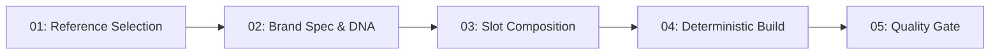

# 📘 Manual Operacional, Ferramentas e Estruturas Essenciais
### Studio DNA PRO (v2.0.0) — Engine & Production Factory

> **Documento Canônico de Arquitetura e Operação.**  
> Este guia documenta **exclusivamente** os componentes, ferramentas, protocolos e estruturas essenciais para a operação, manutenção e expansão do motor. Componentes experimentais, scratchpad temporário, dependências brutas (`node_modules`) e orquestração interna de agentes (`.agents`) foram omitidos intencionalmente para focar no núcleo produtivo.

---

## 📑 Índice

1. [Visão Geral & Filosofia de Arquitetura](#1-visão-geral--filosofia-de-arquitetura)
2. [Estrutura de Diretórios Essenciais](#2-estrutura-de-diretórios-essenciais)
3. [Catálogo de Ferramentas & Executáveis (Tools)](#3-catálogo-de-ferramentas--executáveis-tools)
   - [3.1 CLI Principal & Comandos NPM](#31-cli-principal--comandos-npm)
   - [3.2 Servidor MCP (Model Context Protocol)](#32-servidor-mcp-model-context-protocol)
   - [3.3 Motores do Núcleo (`src/core/`)](#33-motores-do-núcleo-srccore)
   - [3.4 Motores Especializados & Resiliência (`src/pro/`)](#34-motores-especializados--resiliência-srcpro)
   - [3.5 Compilação & Transmutação (`src/pipeline/` e `src/generators/`)](#35-compilação--transmutação-srcpipeline-e-srcgenerators)
   - [3.6 Quality Gates & Auditoria (`src/qa/`)](#36-quality-gates--auditoria-srcqa)
   - [3.7 Servidor de Preview Local (`src/server/`)](#37-servidor-de-preview-local-srcserver)
4. [Governança e Protocolos Operacionais](#4-governança-e-protocolos-operacionais)
   - [4.1 ICM — Interpretable Context Methodology 2.0](#41-icm--interpretable-context-methodology-20)
   - [4.2 Protocolo DNA Lock (P0/P1)](#42-protocolo-dna-lock-p0p1)
   - [4.3 Blindagem Anti-Slop & Injeção AST](#43-blindagem-anti-slop--injeção-ast)
   - [4.4 Isolamento de Clientes & Imutabilidade de Cópias](#44-isolamento-de-clientes--imutabilidade-de-cópias)
5. [Fluxo Operacional Passo a Passo (End-to-End Walkthrough)](#5-fluxo-operacional-passo-a-passo-end-to-end-walkthrough)
6. [Tabela de Referência Rápida de Comandos](#6-tabela-de-referência-rápida-de-comandos)

---

## 1. Visão Geral & Filosofia de Arquitetura

O **Studio DNA PRO** é uma infraestrutura de engenharia reversa para sites web de padrão internacional (Awwwards, Godly, FWA), extração sistemática de **Design DNA** e transmutação determinística orientada por **ICM** (*Interpretable Context Methodology*).

### 🎯 Pilares Centrais:
1. **Reference-Driven Quality**: Em vez de gerar interfaces do zero com estruturas simplórias ("AI slop"), o motor captura esqueletos estruturais de websites reais e preserva 100% de sua física de movimento (Lenis, GSAP ScrollTrigger, WebGL shaders e SplitText).
2. **Separação Rigorosa de Responsabilidades**:
   - **IAs**: Planejam exclusivamente em schemas declarativos (`brand-spec.json`, `content-slots.json`).
   - **Compiladores Determinísticos**: Executam substituições cirúrgicas via AST (Cheerio/PostCSS) sem alucinações de LLM.
   - **Quality Gates Independentes**: Validam em navegadores headless Playwright se o resultado tem **0 erros de console**, **0 requisições 404** e integridade visual idêntica.
3. **Isolamento Absoluto de Clientes**: Cada cliente reside em uma sandbox estritamente isolada. Nunca ocorre cruzamento de tokens, cores, copywriting ou assets entre marcas.

---

## 2. Estrutura de Diretórios Essenciais

Abaixo está o mapa estrutural dos arquivos e diretórios essenciais para o funcionamento do motor:

```text
studio-dna-engine/
├── bin/
│   └── cli.js                     # Ponto de entrada CLI (terminal interativo e flags)
├── src/
│   ├── acquisition/
│   │   └── adapters/              # Adaptadores de ingestão (ex: Shadcn Registry)
│   ├── config/                    # Carregadores de configuração do engine
│   ├── constraints/               # Motor de regras (WCAG AA, tipografia, física, gradientes)
│   ├── core/                      # Núcleo de scraping, detecção e extração de DNA
│   ├── dev/                       # HUD e componentes de visualização em desenvolvimento
│   ├── extractors/                # Compiladores de tokens de design
│   ├── generators/                # Fábricas de clientes, injetores AST e styleguide
│   ├── hub/                       # Catálogo e exportação de componentes GenUI
│   ├── icm/                       # Guardião de isolamento de contexto operacional
│   ├── intelligence/              # Minerador de arquétipos e reversão de movimento
│   ├── mcp-server.js              # Servidor STDIO Model Context Protocol para IAs
│   ├── orchestrator/              # Motor de orquestração do pipeline
│   ├── pipeline/                  # Pipeline de transmutação determinística e rollback
│   ├── presets/                   # Presets de design e sincronia visual
│   ├── pro/                       # Normalizadores avançados de assets, scroll e CDP
│   ├── qa/                        # Unified Quality Gate e Anti-Slop Gate
│   ├── registry/                  # Registro de efeitos e componentes
│   ├── runtime/                   # Runtimes resilientes de scroll e agente
│   ├── server/                    # Servidor local de preview com isolamento estrito
│   └── utils/                     # Barreira de hidratação e utilitários auxiliares
├── icm/
│   ├── CONTEXT.md                 # Manifesto de governança de contexto
│   ├── _core/                     # Contratos de estágios e schemas base
│   └── stages/                    # Especificação dos 5 estágios canônicos
├── design-vault/                  # Banco permanente de inteligência de design
│   ├── 01-motion-physics/         # Curvas de easing cúbico cinematográficas
│   ├── 04-typography/             # Pares tipográficos suíços e regras de clamp()
│   └── <referencias>/             # Fichas técnicas e tokens de referências arquivadas
├── clientes/                      # Sandboxes isoladas de produção por cliente
│   └── <client-slug>/
│       ├── DNA.md                 # Contrato de regras de marca (P0 invariantes / P1 customizáveis)
│       ├── brand-spec.json        # Dicionário declarativo de cores, fontes e estilo
│       ├── content-slots.json     # Copy de todos os slots dentro do budget (±15%)
│       └── site/                  # Artefato de produção final (index.html e assets)
├── copias/                        # Clones de referência puros (READ-ONLY / IMUTÁVEIS)
│   └── <ref-slug>/
│       ├── site/                  # Clone bruto funcional capturado pelo Playwright
│       ├── skeleton.html          # Esqueleto estrutural com marcações de slots
│       └── PIPELINE_STATUS.json   # Relatório de extração dos estágios do engine
├── schemas/                       # Schemas canônicos de validação JSON
│   ├── component_dna.v1.schema.json
│   ├── component_archetype.v1.schema.json
│   ├── component_certification.v1.schema.json
│   └── reference_manifest.v1.schema.json
├── scripts/                       # Scripts utilitários de produção e auditoria
│   ├── box-diff-linter.js         # Linter visual e dimensional headless
│   ├── normalize-all-copies.js    # Normalizador em lote de assets de cópias
│   ├── build-and-certify-pilot.js # Construtor e certificador do Golden Pilot
│   └── dna-extractor.js           # Auditor de design tokens via CLI
├── test/                          # Suíte de testes automatizados (Node Test Runner)
├── index.js                       # Fachada programática principal da biblioteca
├── package.json                   # Dependências, scripts operacionais e metadados
├── README.md                      # Apresentação do repositório e guia rápido
├── ICM.md                         # Documentação canônica da metodologia ICM 2.0
└── PROJECT_STATUS.md              # Ledger de claims versus evidências comprovadas
```

---

## 3. Catálogo de Ferramentas & Executáveis (Tools)

### 3.1 CLI Principal & Comandos NPM

O motor disponibiliza uma interface CLI interativa e comandos NPM diretos para automação de tarefas.

#### Comandos NPM Padronizados:

| Comando | Script Alvo | Propósito Operacional |
| :--- | :--- | :--- |
| `npm run setup` | Playwright Install | Baixa e configura o binário do Chromium com dependências do sistema. |
| `npm run scrape` | `bin/cli.js` | Executa o deep scraper e pipeline de extração de DNA de design. |
| `npm start` | `bin/cli.js --preview` | Inicia o servidor local de visualização e dashboard em `http://127.0.0.1:4000/`. |
| `npm run preview` | `bin/cli.js --preview` | Alias para iniciar o servidor de preview local. |
| `npm run client` | `src/generators/client-factory.js` | Cria um novo projeto de cliente isolado a partir de um esqueleto do Vault. |
| `npm run inject` | `src/generators/slot-injector.js` | Injeta slots de copy mecanicamente no esqueleto HTML. |
| `npm run tokens` | `src/extractors/token-compiler.js` | Compila tokens CSS/JS a partir do esqueleto analisado. |
| `npm run audit` | `scripts/box-diff-linter.js` | Audita integridade dimensional, console e assets via Playwright. |
| `npm run normalize`| `scripts/normalize-all-copies.js` | Higieniza paths relativos e referências de assets nas cópias. |
| `npm test` | `node --test test/*.test.js` | Executa a suíte de testes de regressão e integração do repositório. |

#### Opções do CLI (`bin/cli.js`):

```bash
# Execução interativa (guia passo a passo com menu)
node bin/cli.js

# Extração completa de uma URL (Assets + DNA + UI/UX + Master Spec)
node bin/cli.js https://exemplo.com --mode all

# Extração em modo headed (com janela de navegador visível para depuração)
node bin/cli.js https://exemplo.com --headed

# Apenas extração de tokens de design e styleguide visual
node bin/cli.js https://exemplo.com --mode dna

# Iniciar servidor de preview em porta customizada
node bin/cli.js --preview --port 4000

# Iniciar servidor de preview em modo somente leitura (bloqueia APIs de mutação)
node bin/cli.js --preview --read-only
```

---

### 3.2 Servidor MCP (Model Context Protocol)

O arquivo [`src/mcp-server.js`](file:///c:/Users/USER/Documents/scraper%20e%20extracor/studio-dna-engine/src/mcp-server.js) implementa um servidor MCP padrão via transporte STDIO (`@modelcontextprotocol/sdk`). Ele permite que agentes e IAs operem o motor programaticamente com ferramentas tipadas (Zod).

#### Ferramentas Expostas:

1. **`scrape_and_extract_dna`**:
   - *Descrição*: Executa o Playwright Deep Scraper em uma URL de referência, baixando assets, extraindo tokens e gerando o esqueleto em `copias/`.
   - *Parâmetros*: `url` (string, obrigatória), `mode` (`all` | `clone` | `dna` | `ui`).
2. **`create_client_project`**:
   - *Descrição*: Cria uma pasta isolada em `clientes/<slug>` contendo `DNA.md`, `brand-spec.json`, esqueleto derivado e manifesto inicial.
   - *Parâmetros*: `brandName`, `refSlug`, `niche`, `toneOfVoice`, `whatsapp`.
3. **`inject_content_slots`**:
   - *Descrição*: Injeta o dicionário de copy do cliente deterministicamente no esqueleto HTML via AST, consumindo 0 tokens na montagem.
   - *Parâmetros*: `skeletonPath`, `contentSlotsPath`, `outputPath`.
4. **`run_quality_gate_audit`**:
   - *Descrição*: Executa a auditoria Playwright headless checando 0 erros de JavaScript, 0 imagens quebradas e validação geométrica.
   - *Parâmetros*: `siteSlug` (ex: `clientes/piloto-elyse-luxe`).

#### Recursos Expostos:
- `vault://easings`: Retorna o catálogo de curvas de física cúbica de movimento (`design-vault/01-motion-physics/easings.json`).
- `vault://typography`: Retorna pares tipográficos curados para sites premium (`design-vault/04-typography/curated-pairings.json`).

---

### 3.3 Motores do Núcleo (`src/core/`)

Componentes responsáveis pela dissecação precisa das referências web:

- [`cloner.js`](file:///c:/Users/USER/Documents/scraper%20e%20extracor/studio-dna-engine/src/core/cloner.js):
  - Orquestra o Playwright em ambiente real.
  - Implementa bloqueio e interceptação de rede para download local de assets (imagens, SVGs, fontes WOFF2, áudio, vídeos e shaders).
  - Executa sanitização de scripts de tracking externos (Google Analytics, Facebook Pixel, Tag Manager).
- [`detector.js`](file:///c:/Users/USER/Documents/scraper%20e%20extracor/studio-dna-engine/src/core/detector.js):
  - Detecta a pilha tecnológica da referência (Webflow, Next.js, Framer, Shopify, Tailwind, GSAP, Lenis, Locomotive, Three.js).
- [`deterministic-capture-engine.js`](file:///c:/Users/USER/Documents/scraper%20e%20extracor/studio-dna-engine/src/core/deterministic-capture-engine.js):
  - Captura snapshots do DOM e CSS computado com verificação estrita de divergência ($\Delta = 0$).
- [`dna-extractor.js`](file:///c:/Users/USER/Documents/scraper%20e%20extracor/studio-dna-engine/src/core/dna-extractor.js):
  - Analisa as folhas de estilo e o DOM computado para extrair a paleta de cores primárias/secundárias, escala modular tipográfica, raios de borda e gaps de layout.
- [`ui-ux-extractor.js`](file:///c:/Users/USER/Documents/scraper%20e%20extracor/studio-dna-engine/src/core/ui-ux-extractor.js):
  - Disseca micro-interações, gatilhos de scroll (`ScrollTrigger`), classes de cursor customizado e estados de hover/focus.

---

### 3.4 Motores Especializados & Resiliência (`src/pro/`)

Motores avançados que garantem a operabilidade offline e estabilidade do clone:

- [`advanced-asset-interceptor.js`](file:///c:/Users/USER/Documents/scraper%20e%20extracor/studio-dna-engine/src/pro/advanced-asset-interceptor.js):
  - Utiliza o Chrome DevTools Protocol (CDP) para interceptar recursos carregados dinamicamente via Web Workers, requisições AJAX ou injeções pós-hidratação.
- [`universal-asset-normalizer.js`](file:///c:/Users/USER/Documents/scraper%20e%20extracor/studio-dna-engine/src/pro/universal-asset-normalizer.js):
  - Reescreve todas as URLs absolutas e referências externas (`https://...`) em links relativos locais seguros (`./assets/...`), garantindo funcionamento 100% offline.
- [`universal-scroll-director.js`](file:///c:/Users/USER/Documents/scraper%20e%20extracor/studio-dna-engine/src/pro/universal-scroll-director.js):
  - Normaliza e estabiliza bibliotecas de scroll inercial (Lenis, Locomotive) e animações baseadas em timeline, impedindo bloqueios de scroll ou saltos de viewport.
- [`gsap-reverser.js`](file:///c:/Users/USER/Documents/scraper%20e%20extracor/studio-dna-engine/src/pro/gsap-reverser.js):
  - Reverte e reconstrói parâmetros originais de tweens GSAP para garantir que animações continuem funcionando após a injeção de novas cópias.

---

### 3.5 Compilação & Transmutação (`src/pipeline/` e `src/generators/`)

Substituição mecânica determinística de conteúdos sem intervenção de escrita livre por IA:

- [`pipeline-runner.js`](file:///c:/Users/USER/Documents/scraper%20e%20extracor/studio-dna-engine/src/pipeline/pipeline-runner.js):
  - Executa ordenadamente as 9 etapas da extração inicial, gerando relatórios de evidência imutáveis.
- [`transmuter.js`](file:///c:/Users/USER/Documents/scraper%20e%20extracor/studio-dna-engine/src/pipeline/transmuter.js):
  - Compilador universal responsável por ler o `brand-spec.json` e aplicar tokens de cores e tipografia de forma idempotente sobre o HTML de produção.
- [`client-factory.js`](file:///c:/Users/USER/Documents/scraper%20e%20extracor/studio-dna-engine/src/generators/client-factory.js):
  - Inicializa a estrutura completa de um novo cliente isolado com templates validados e hashes SHA-256.
- [`slot-injector.js`](file:///c:/Users/USER/Documents/scraper%20e%20extracor/studio-dna-engine/src/generators/slot-injector.js) & [`ast-injector.js`](file:///c:/Users/USER/Documents/scraper%20e%20extracor/studio-dna-engine/src/generators/ast-injector.js):
  - Parseiam o HTML em árvore AST com Cheerio e realizam a substituição cirúrgica dos seletores com os valores de `content-slots.json`.
- [`clean-room-compiler.js`](file:///c:/Users/USER/Documents/scraper%20e%20extracor/studio-dna-engine/src/generators/clean-room-compiler.js):
  - Extrai e compila componentes isolados em código limpo React TSX / Tailwind livre de dependências proprietárias do scraper.
- [`styleguide.js`](file:///c:/Users/USER/Documents/scraper%20e%20extracor/studio-dna-engine/src/generators/styleguide.js):
  - Gera um HTML visual e interativo apresentando a paleta de cores, tipografia e botões extraídos da referência.
- [`tailwind-generator.js`](file:///c:/Users/USER/Documents/scraper%20e%20extracor/studio-dna-engine/src/generators/tailwind-generator.js):
  - Emite o arquivo `tailwind.config.js` sincronizado com os tokens canônicos do projeto.

---

### 3.6 Quality Gates & Auditoria (`src/qa/`)

Mecanismos de prova de verdade operacional:

- [`unified-quality-gate.js`](file:///c:/Users/USER/Documents/scraper%20e%20extracor/studio-dna-engine/src/qa/unified-quality-gate.js):
  - Executa uma sessão headless no Playwright inspecionando:
    1. **Console**: Garante 0 chamadas de `console.error` ou erros de exceção no runtime.
    2. **Network**: Garante que nenhuma requisição retorne código HTTP 404 ou falha de transporte.
    3. **Assets**: Valida se todas as imagens carregadas possuem `naturalWidth > 0`.
    4. **Layout**: Confere bounding boxes e integridade da árvore DOM.
- [`anti-slop-gate.js`](file:///c:/Users/USER/Documents/scraper%20e%20extracor/studio-dna-engine/src/qa/anti-slop-gate.js):
  - Analisador semântico determinístico:
    - **Length Budget**: Verifica se os textos do cliente estão dentro do orçamento de $\pm 15\%$ em relação aos textos originais da referência.
    - **Resíduos**: Varre e rejeita menções de domínios, emails, nomes da marca original clonada ou textos padrão ("Lorem Ipsum", "Template").
    - **Slots Órfãos**: Impede a existência de slots não preenchidos no artefato compilado.
- [`box-diff-linter.js`](file:///c:/Users/USER/Documents/scraper%20e%20extracor/studio-dna-engine/scripts/box-diff-linter.js):
  - Validador visual e dimensional executável via linha de comando (`npm run audit`).

---

### 3.7 Servidor de Preview Local (`src/server/`)

- [`preview-server.js`](file:///c:/Users/USER/Documents/scraper%20e%20extracor/studio-dna-engine/src/server/preview-server.js):
  - Servidor Express projetado para desenvolvimento visual seguro.
  - Vinculado estritamente à interface local **`127.0.0.1:4000`** (nunca exposto em `0.0.0.0`).
  - Painel de controle visual com rotas para navegar entre referências brutas (`/copias/...`) e clientes (`/clientes/...`).
  - Suporte a HUD de desenvolvimento para ajuste de propriedades em tempo real.
- [`security.js`](file:///c:/Users/USER/Documents/scraper%20e%20extracor/studio-dna-engine/src/server/security.js):
  - Bloqueio estrito de *Path Traversal* (`../`).
  - Restrição de origens CORS e validação de tokens para APIs mutáveis.

---

## 4. Governança e Protocolos Operacionais

### 4.1 ICM — Interpretable Context Methodology 2.0

O ICM governa **o que qualquer agente ou script pode ler, planejar e produzir**. Ele impede que o contexto da IA seja poluído com arquivos gigantescos ou dados de clientes não relacionados.

#### Os 5 Estágios Canônicos:



1. **Estágio 01: Seleção de Referência (`01-reference-selection`)**:
   - *Entrada*: Briefing de requisitos do cliente; `design-vault/INDEX.json`.
   - *Saída*: `reference-selection.json` indicando a referência compatível ($\ge 85\%$).
2. **Estágio 02: Especificação de Marca (`02-brand-spec`)**:
   - *Entrada*: `reference-selection.json` e tokens do Vault da referência escolhida.
   - *Saída*: `clientes/<slug>/brand-spec.json` e `DNA.md` (com regras P0/P1).
3. **Estágio 03: Composição de Conteúdo (`03-slot-composition`)**:
   - *Entrada*: `brand-spec.json` e esqueleto de slots da referência.
   - *Saída*: `clientes/<slug>/content-slots.json` com textos no budget de $\pm 15\%$.
4. **Estágio 04: Compilação Determinística (`04-build-compilation`)**:
   - *Entrada*: `skeleton.html`, `content-slots.json` e `brand-spec.json`.
   - *Execução*: Injeção mecânica AST via `src/pipeline/transmuter.js`.
   - *Saída*: `clientes/<slug>/site/index.html` compilado.
5. **Estágio 05: Quality Gate & Auditoria (`05-quality-gate`)**:
   - *Entrada*: `clientes/<slug>/site/index.html` e `DNA.md`.
   - *Saída*: `linter-report.json` comprovando 0 erros JS, 0 erros 404 e 0 resíduos.

---

### 4.2 Protocolo DNA Lock (P0/P1)

O arquivo `DNA.md` de cada cliente define os invariantes de marca que nenhuma IA pode alterar:

- **Regras P0 (Invariantes Estritas)**:
  - Exemplos: Contraste mínimo WCAG AA em botões CTA, paleta primária base inviolável, ausência total de bibliotecas de terceiros externas/CDNs não declaradas.
  - *Comportamento*: Falha imediatamente qualquer tentativa de alteração sem autorização explícita registrada.
- **Regras P1 (Customizáveis)**:
  - Exemplos: Textos secundários, variações sutis de padding, ícones informativos.

---

### 4.3 Blindagem Anti-Slop & Injeção AST

Sites premiados possuem páginas de até 10MB com dezenas de milhares de linhas contendo cálculos complexos de física de scroll. 

> [!IMPORTANT]
> **Nunca permita que um LLM reescreva o arquivo HTML inteiro diretamente no chat.**
> LLMs descartam 90% da estrutura devido ao limite de tokens de saída, destruindo a cinemática da página. A IA deve **apenas preencher o JSON de slots (`content-slots.json`)**, deixando a montagem física a cargo do injetor AST determinístico ([`src/generators/slot-injector.js`](file:///c:/Users/USER/Documents/scraper%20e%20extracor/studio-dna-engine/src/generators/slot-injector.js)).

---

### 4.4 Isolamento de Clientes & Imutabilidade de Cópias

1. **`copias/` é estritamente READ-ONLY**:
   - Clones em `copias/<ref-slug>/` servem como evidência primária e esqueleto intocável. Jamais altere um arquivo em `copias/` diretamente.
2. **Isolamento de Diretórios**:
   - Durante a edição de `clientes/cliente-A/`, nenhum arquivo de `clientes/cliente-B/` deve ser lido ou importado.

---

## 5. Fluxo Operacional Passo a Passo (End-to-End Walkthrough)

Siga este procedimento para clonar uma nova referência e produzir um site de cliente:

### Passo 1: Scraping e Extração da Referência
Execute o scraper informando a URL alvo:
```bash
node bin/cli.js https://exemplo-awwwards.com --mode all
```
*Resultado*: A pasta `copias/exemplo-awwwards-com/` conterá o clone funcional, o `skeleton.html`, o relatório `PIPELINE_STATUS.json` e os tokens de design.

### Passo 2: Criar a Sandbox do Cliente
Instancie o novo cliente a partir da referência extraída:
```bash
node src/generators/client-factory.js --brand "Nova Marca" --ref "exemplo-awwwards-com"
```
*Resultado*: Diretório `clientes/nova-marca/` criado com `DNA.md`, `brand-spec.json` e esqueleto inicial.

### Passo 3: Definir Especificação de Marca e Copy
1. Configure cores e tipografia no arquivo [`clientes/nova-marca/brand-spec.json`](file:///c:/Users/USER/Documents/scraper%20e%20extracor/studio-dna-engine/clientes/).
2. Redija os textos no arquivo `clientes/nova-marca/content-slots.json` respeitando os limites de caracteres originais (Length Rule: $\pm 15\%$).

### Passo 4: Compilar Deterministicamente
Dispare o compilador para mesclar o esqueleto aos slots:
```bash
node src/generators/slot-injector.js \
  --skeleton "copias/exemplo-awwwards-com/skeleton.html" \
  --slots "clientes/nova-marca/content-slots.json" \
  --out "clientes/nova-marca/site/index.html"
```

### Passo 5: Auditar via Quality Gate e Testar
Execute a auditoria automatizada:
```bash
node scripts/box-diff-linter.js clientes/nova-marca
```
Inicie o servidor e abra no navegador:
```bash
npm start
```
Acesse **`http://127.0.0.1:4000/clientes/nova-marca/site/index.html`** para validação visual final.

---

## 6. Tabela de Referência Rápida de Comandos

| Necessidade Operacional | Comando de Terminal |
| :--- | :--- |
| **Instalação Inicial** | `npm install && npm run setup` |
| **Executar Testes Unitários/E2E** | `npm test` |
| **Iniciar Dashboard de Preview** | `npm start` (porta padrão: 4000) |
| **Preview Somente Leitura** | `node bin/cli.js --preview --read-only` |
| **Dissecar URL via Scraper** | `node bin/cli.js https://url-alvo.com` |
| **Scraping com Navegador Visível** | `node bin/cli.js https://url-alvo.com --headed` |
| **Criar Novo Cliente** | `npm run client -- --brand "Nome" --ref "slug-referencia"` |
| **Injetar Slots de Conteúdo** | `npm run inject` |
| **Compilar Tokens de Design** | `npm run tokens` |
| **Auditar Cliente com Quality Gate** | `npm run audit clientes/<slug-do-cliente>` |
| **Normalizar Assets de Cópias** | `npm run normalize` |

---

> **Mantenha este documento atualizado:** Sempre que novas ferramentas canônicas, schemas ou contratos forem consolidados no repositório, registre suas especificações neste manual.
