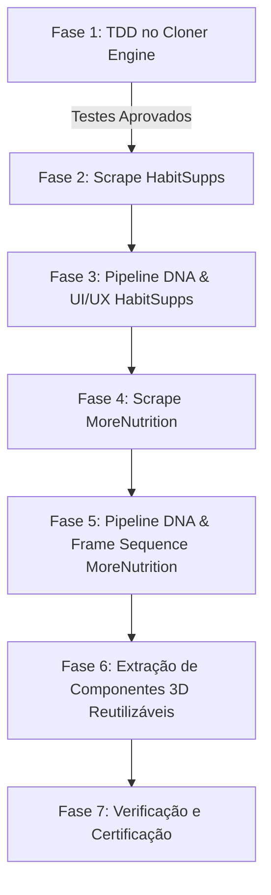

# Plano de Execução: Scraping, Análise de Assets 3D/Vídeo e Pipeline Engine

## Visão Geral
O objetivo deste trabalho é preparar e executar o scraping completo e a ingestão de duas referências de alto padrão no pipeline do `studio-dna-engine`:
1. **Habit Supplements** (`https://www.habitsupps.com/product/stress-relief-capsule` e `https://www.habitsupps.com/`)
2. **More Nutrition** (`https://more-nutrition.webflow.io/#reviews`)

Além da clonagem estática, analisamos a fundo a engenharia dos **assets 3D e de vídeo** de ambas as aplicações para permitir que futuramente o usuário altere o branding, troque mascotes/embalagens e reutilize os conceitos de forma modular no ecossistema ICM (`clientes/`).

---

## 🔬 Diagnóstico e Evidências Técnicas (Truth Protocol)

### 1. Habit Supplements (`habitsupps.com`)
- **Arquitetura Detectada (`observed`):** Next.js 14+ (App Router) com Sanity CMS (`cdn.sanity.io`).
- **Natureza dos Assets 3D (`observed`):**
  - O mascote 3D **NÃO é um render em tempo real Three.js/WebGL** (0 instâncias de canvas ou shaders encontradas).
  - Trata-se de uma **identidade 3D pré-renderizada com canal alfa** exportada em loops animados de alta fidelidade:
    - **Mascote com Carrinho de Compras (da captura do usuário)**: `https://cdn.sanity.io/images/iuz0iuzl/production/5b0d53ac00d7f197f5db23d5d80be01a9fbbff5f-500x327.gif` (1.89 MB).
    - **Mascote nas Reviews**: `https://cdn.sanity.io/images/iuz0iuzl/production/53dea3834f2ce8dc6e4049e84b1dc6d3240a94c3-500x774.gif` (1.58 MB, classe `.habit-character3`).
    - **Mascote no Rodapé (Pop-out lateral)**: `/_next/static/media/habit-character-popping-out-from-side-of-image.e4b794c0.gif`.
    - **Mascote no 404 (Pulando corda)**: `/_next/static/media/habit-character-jumprope.71946dee.gif`.
    - **Vídeos dos Ingredientes Chave (MP4)**: 10 vídeos MP4 na CDN do Sanity (`.product-video`) integrados aos cards de ingredientes e carrossel.
- **Como Rebrandear e Reutilizar o Conceito:**
  - O conceito arquitetural é o **Brand Mascot Slot System**: elementos de layout flutuantes e contextuais.
  - Para rebrandear em clientes novos: modela-se o mascote ou frasco 3D da marca cliente (em Blender/Spline/Cinema4D), exporta-se como GIF/WebP transparente (ou Lottie/DotLottie) e substitui-se declarativamente via slot injector.

### 2. More Nutrition (`more-nutrition.webflow.io/#reviews`)
- **Arquitetura Detectada (`observed`):** Webflow + scripts externos hospedados na Vercel (`https://morematcha.vercel.app/`).
- **Natureza dos Assets 3D e Vídeo (`observed`):**
  - **Stage Hero (Hero Visual)**: `<canvas class="stage-canvas">` que consome 23 frames WebP (`seq_1_0.webp` até `seq_1_22.webp`) decodificados via `createImageBitmap` e desenhados em canvas 60fps.
  - **Scroll-Driven 3D Product Scrubbing**: `<canvas class="sequence-canvas">` que consome **200 frames WebP** (`seq_0_0.webp` até `seq_0_199.webp`) de render 3D da lata de Matcha girando e reagindo ao scroll via `GSAP ScrollTrigger` scrub.
  - **Vídeos UGC de Depoimentos**: 3 vídeos MP4 verticais com controle de som/mute customizado hospedados no Dropbox.
  - **Lottie Player**: Animação vetorial do logo (`more-logo-animation.json`).
  - **Lenis Smooth Scroll & SplitText**: Movimento inercial com tipografia revelada por linhas e palavras.
- **Como Rebrandear e Reutilizar o Conceito:**
  - O conceito é o **Apple-Style Canvas Image Sequence**: o produto do novo cliente é renderizado em 360° em 120-200 frames WebP transparentes e controlado por scroll no canvas com o mesmo script e pinning.

---

## ⚠️ Gaps Identificados no Scraper Atual (`src/core/cloner.js`)

Para que o pipeline atual do `studio-dna-engine` capture ambos os sites com fidelidade 100% autônoma, precisamos corrigir 2 bloqueadores no cloner:
1. **Filtro de CDNs (`isAllowedAssetUrl`):** Atualmente bloqueia `cdn.sanity.io`, `morematcha.vercel.app` e `dl.dropboxusercontent.com`. Sem permitir esses domínios, o cloner descarta os vídeos, os GIFs do mascote e as 223 imagens do canvas sequence.
2. **Download das Sequências de Canvas e Imagens Dinâmicas:** Os 200 frames de `seq_0_*.webp` e 23 frames de `seq_1_*.webp` são carregados dinamicamente via JS (`new Image().src = ...`). O scraper precisa mapear esses caminhos ou baixá-los para `site/assets/vendor/morematcha.vercel.app/img/` para que o site clonado funcione offline / no preview local sem quebras.

---

## 🔴 Ciclo TDD (TDD-Workflow)

Seguiremos rigorosamente o protocolo **RED → GREEN → REFACTOR**:

1. **🔴 RED**: Criar teste unitário em `test/cloner-cdn-allowlist.test.js` comprovando que `isAllowedAssetUrl` e a rotina de detecção de assets falham ao tentar validar e baixar assets essenciais de `cdn.sanity.io`, `*.vercel.app` e extensões de vídeo/sequência.
2. **🟢 GREEN**: Atualizar `isAllowedAssetUrl` e as regras de assets em `src/core/cloner.js` para suportar CDNs de mídia e renderizadores modernos de forma segura (sem permitir trackers de telemetria).
3. **🔵 REFACTOR**: Garantir isolamento, sanitização de caminhos locais e que nenhum arquivo em `copias/` seja alterado de forma manual (preservando o contrato de imutabilidade ICM).

---

## Fases de Execução



### Fase 1: Suporte e Testes Unitários TDD
- Criar teste `test/cloner-cdn-allowlist.test.js`.
- Adicionar padrões permitidos: `cdn.sanity.io`, `*.vercel.app`, `*.dropboxusercontent.com`.
- Adicionar lógica de captura para endpoints de sequências (`seq_0_*`, `seq_1_*`).

### Fase 2 & 3: Scraping & Pipeline Habit Supplements
- **Alvo:** `https://www.habitsupps.com/product/stress-relief-capsule`
- Executar via pipeline:
  ```bash
  node bin/cli.js https://www.habitsupps.com/product/stress-relief-capsule --mode all
  ```
- Gerar:
  - `copias/habitsupps-com/site/` (HTML, CSS, imagens de produto, mascotes GIF, vídeos de ingredientes).
  - `copias/habitsupps-com/design-system/` (`design-system.html`, tokens de cor, tipografia).
  - `copias/habitsupps-com/ui-ux/` (micro-interações, accordion, carrosséis de produtos).
  - `copias/habitsupps-com/MASTER_SPEC.md` e `assets-manifest.json`.

### Fase 4 & 5: Scraping & Pipeline More Nutrition
- **Alvo:** `https://more-nutrition.webflow.io/#reviews`
- Baixar o bundle Webflow + scripts Vercel (`app.js`, `main.css`).
- Baixar a sequência completa de 200 frames (`seq_0_0.webp` a `seq_0_199.webp`) e 23 frames (`seq_1_0.webp` a `seq_1_22.webp`).
- Gerar:
  - `copias/more-nutrition-webflow-io/site/` com canvas interativo funcional localmente.
  - `copias/more-nutrition-webflow-io/MASTER_SPEC.md` detalhando o scroll canvas scrubber.

### Fase 6: Módulo de Reuso de Conceito (Slot System & Canvas Engine)
- Documentar em `src/registry/effects/` ou em pasta de specs:
  1. `brand-mascot-slots.json`: Especificação de slots para mascotes 3D animados (header, carousel badge, reviews card, 404).
  2. `canvas-scroll-scrubber.json`: Componente declarativo para scrub de sequência de frames 3D de produto.

---

## Plano de Verificação

### 1. Testes Automatizados (TDD)
```bash
npm test
```
Verificar que todos os testes existentes e o novo teste de CDNs passam com 0 falhas.

### 2. Validação dos Clones
```bash
node scripts/box-diff-linter.js
```
Verificar integridade dos esqueletos gerados em `copias/habitsupps-com` e `copias/more-nutrition-webflow-io`.

### 3. Validação do Preview Local
```bash
npm run preview
```
Acessar `http://localhost:4000` e verificar que:
1. HabitSupps exibe o carrossel, mascote no carrinho e vídeos de ingredientes sem erros no console.
2. MoreNutrition executa a rotação 3D da lata no canvas durante o scroll.
